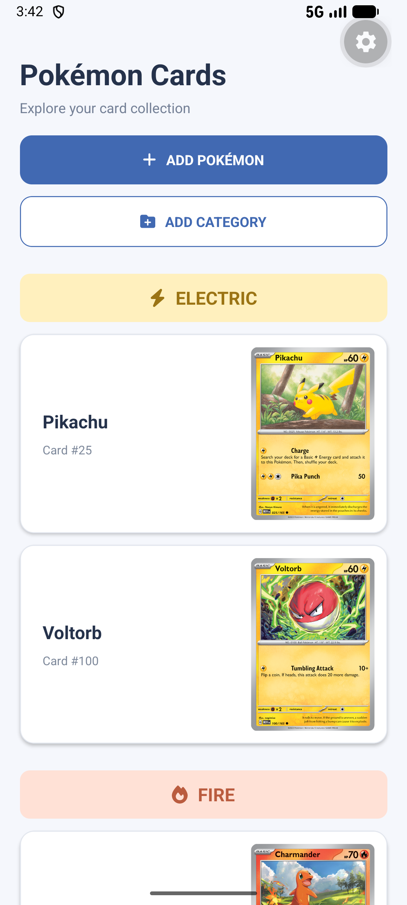
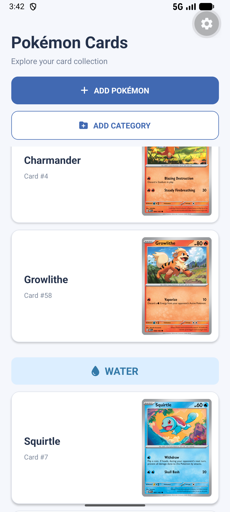
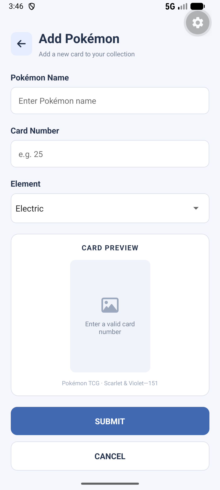
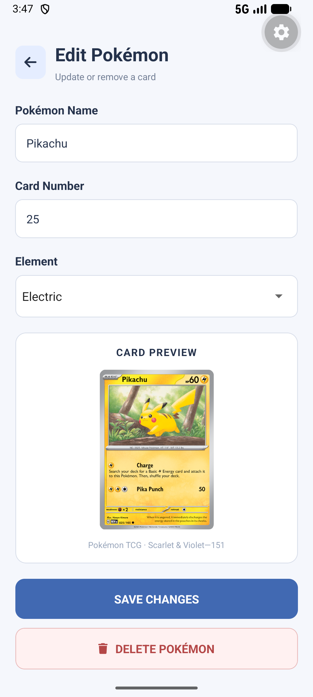
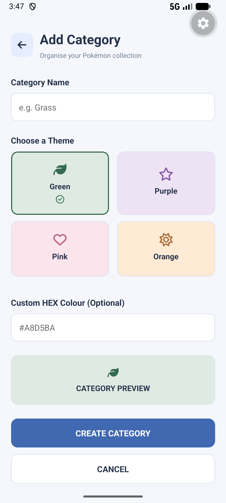
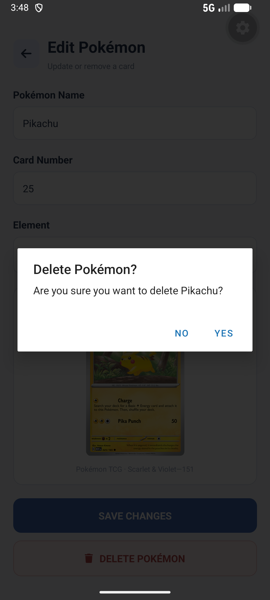

# Pokémon Cards — C346 Mobile App Development

A React Native mobile application built using Expo for C346 Mobile App Development at Republic Polytechnic.

The app allows users to browse, add, edit and delete Pokémon card entries organised into categories. It also supports custom collection categories and online Pokémon card previews.

## Features

- **Browse Pokémon Cards:** View Pokémon in grouped sections using SectionList.
- **Add Pokémon:** Enter a name, card number and category to add a new card.
- **Edit Pokémon:** Update card details or move a Pokémon to another category.
- **Delete Pokémon:** Remove cards with a confirmation alert.
- **Online Card Preview:** Display Pokémon TCG card images based on card numbers.
- **Custom Categories:** Create new collection categories and select predefined themes.
- **Custom HEX Colours:** Enter a HEX colour code and preview the result.
- **React Navigation:** Navigate between Home, Add Pokémon, Edit Pokémon and Add Category screens.

## Screenshots

### Home Screen

| Home — Part 1 | Home — Part 2 |
|:---:|:---:|
|  |  |

### Pokémon Management

| Add Pokémon | Edit Pokémon |
|:---:|:---:|
|  |  |

### Category Management & Confirmation

| Add Category | Delete Confirmation |
|:---:|:---:|
|  |  |

## Demo Video

[Watch the Pokémon Cards App Demo](YOUR_VIDEO_URL_HERE)

## Technologies Used

- React Native
- Expo
- JavaScript
- React Navigation (Native Stack)
- React Hooks (`useState`)
- React Native `SectionList`
- React Native `StyleSheet` and Flexbox
- React Native Picker
- Expo FontAwesome6 Icons

## Project Structure

```text
PokemonCards/
├── components/
│   ├── PokemonCard.js
│   └── CardPreview.js
├── App.js
├── Navigation.js
├── Home.js
├── Add.js
├── Edit.js
├── AddCategory.js
├── Data.js
├── screenshots/
│   ├── home1.png
│   ├── home2.png
│   ├── add-pokemon.png
│   ├── edit-pokemon.png
│   ├── add-category.png
│   └── delete-confirmation.png
├── package.json
└── README.md
```

## Getting Started

1. Clone or download the repository.
2. Open the project directory in a terminal.
3. Install dependencies:

   ```bash
   npm install
   ```

4. Start the Expo development server:

   ```bash
   npx expo start
   ```

5. Open the app in an Android Emulator by pressing `a`, or run:

   ```bash
   npm run android
   ```

## Image Credits

Pokémon card images are loaded from the online image URLs used in the C346 Week 5 Pokémon Cards exercise.

- Pokémon TCG Gallery: https://tcg.pokemon.com/en-us/galleries/151/
- Pokémon TCG © Nintendo, Creatures Inc., GAME FREAK inc.

Card images are used for educational demonstration. This is an unofficial student project and is not affiliated with or endorsed by The Pokémon Company.

## Learning Outcomes

This project demonstrates:

- Creating reusable React Native components.
- Displaying grouped data with SectionList.
- Managing user inputs using TextInput, Picker and useState.
- Implementing multi-screen navigation.
- Passing data between screens with route parameters.
- Adding, updating and deleting items from shared arrays.
- Applying StyleSheet, Flexbox and dynamic colours.
- Handling confirmation alerts and online images.

## Limitations

Pokémon cards and custom categories are stored in memory and reset after the app restarts.

The card preview uses a specific Pokémon TCG expansion URL pattern. Image availability and consistency with manually entered Pokémon names are not guaranteed.

## Academic Context

Developed as part of the C346 Mobile App Development Week 5–6 exercises at Republic Polytechnic.